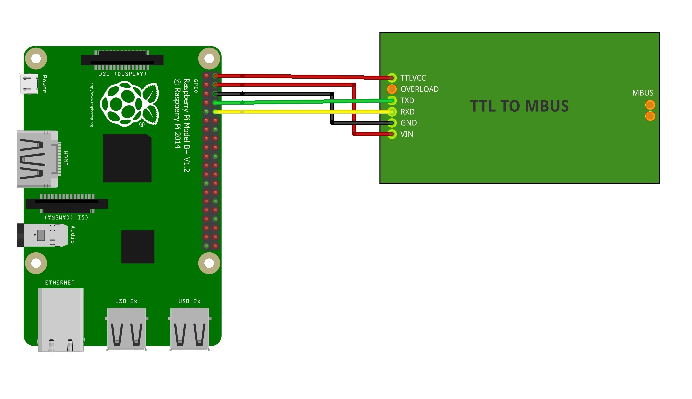

# Hardware Setup

## Raspberry Pi with TTL-to-M-Bus Converter

**Important: Disconnect all power before wiring!**

### Step 1: Enable UART

```bash
sudo raspi-config
```

Navigate to: `3 Interface Options` → `Serial Port` → `No` (login shell) → `Yes` (hardware enabled)

Reboot the Pi.

### Step 2: Connect the Adapter

Connect the TTL-to-M-Bus adapter to the Raspberry Pi GPIO:

| Raspberry Pi | TTL-to-M-Bus |
|--------------|--------------|
| Pin 2 (5V)   | TTLVCC       |
| Pin 4 (5V)   | VIN          |
| Pin 6 (GND)  | GND          |
| Pin 8 (TX)   | TXD          |
| Pin 10 (RX)  | RXD          |



See [pinout.xyz](https://pinout.xyz/) for GPIO pin locations.

### Step 3: Verify

After powering on, the device should be available at `/dev/ttyAMA0` or `/dev/serial0`.

## USB-to-M-Bus Adapter

Simply plug in the USB adapter. It will typically appear as `/dev/ttyUSB0` or `/dev/ttyACM0`.

Check with:

```bash
ls -l /dev/ttyUSB* /dev/ttyACM*
```

## IPv4 TCP using ser2net

You can run libmbus2mqtt on one device and access M-Bus Master connected to another one. Below is an example how to configure that:

### Step 1: Connect M-Bus Master to a linux device

Use the information above and note the device path.

### Step 2: Install and configure ser2net

```bash
sudo apt update && sudo apt install ser2net -y
sudo nano /etc/ser2net.yaml
```

Remove existing ser2net config if not used.
Create new entry for your M-Bus Master (example for Raspberry Pi UART):

```yaml
connection: &uart0
  accepter: tcp(nodelay=true),0.0.0.0,4001
  enable: on
  options:
    kickolduser: true
    chardelay: false
  connector:  serialdev,/dev/ttyAMA0,2400e81,local
```

- `4001` is the TCP port number over which your M-Bus Master will be available.
- `0.0.0.0` means that the ser2net will open port on all IP interfaces configured on the linux host. You can specify a single IP here if needed.
- `/dev/ttyAMA0` is the M-Bus master device path
- `2400e81` - serial settings:
  - speed: `2400` baud
  - parity: `e` (even)
  - data bits: `8`
  - stop bits: `1`

Start the ser2net service:

```bash
sudo systemctl enable ser2net
sudo systemctl start ser2net
```

You might also need to open firewall if used (inbound TCP/4001)

### Step 3: Configure libmbus2mqtt

In libmbus2mqtt `config.yaml` file you just need to set mbus.device to IP:4001, e.g.:

```yaml
mbus:
  device: '192.168.1.50:4001'
```

> [!IMPORTANT]
> M-Bus scan over TCP can take up to 20 minutes! Currently it should take around 5 minutes if using Docker.
