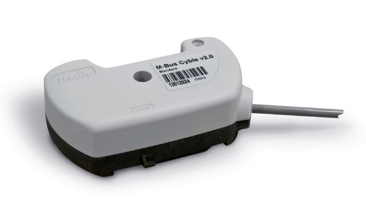
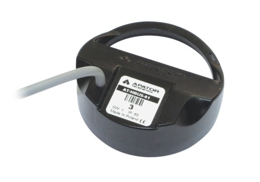
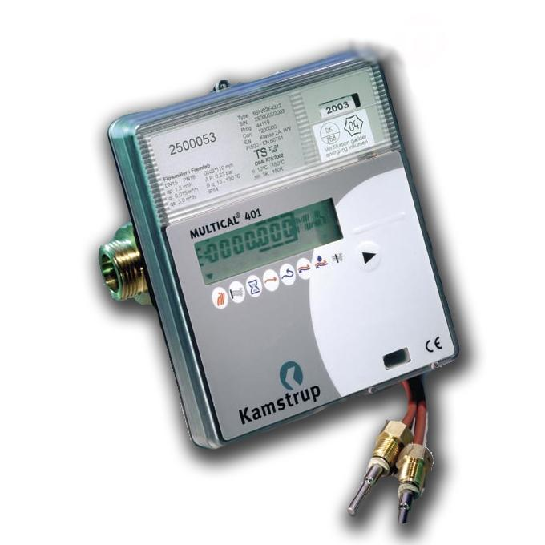
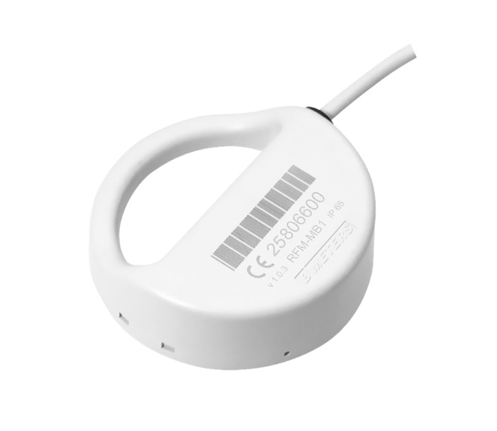
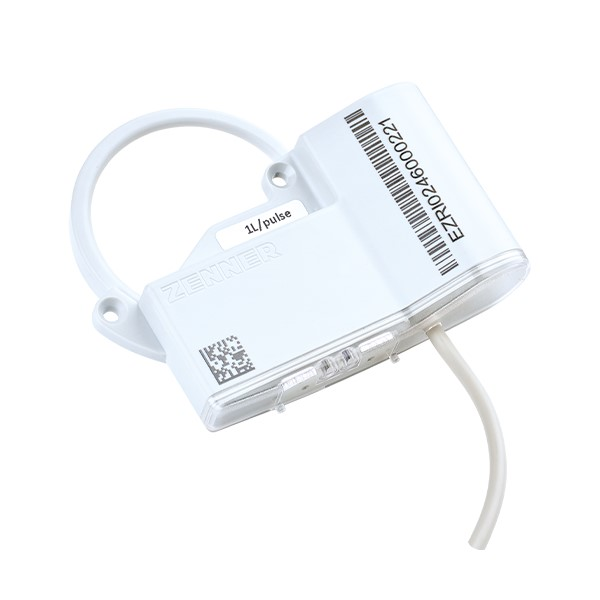

# Supported Devices

libmbus2mqtt includes templates for the devices listed below.
If your device isn't listed, libmbus2mqtt should still work - it creates generic sensors for all data records.
For a better experience, you can [create a custom template](templates.md#custom-templates) or [request one](https://github.com/nilvanis/libmbus2mqtt/issues).

## Itron Cyble M-Bus
\
Data sheet: https://se.itron.com/o/commerce-media/accounts/-1/attachments/3809944

## APATOR APT-MBUS-NA-1
\
Data sheet: https://api.apator.com/uploads/oferta/woda-i-cieplo/systemy/przewodowy/apt-mbus-na/apt-mbus-na-1-catalogue.pdf

## Kamstrup Multical 401
\
Data Sheet: https://documentation.kamstrup.com/docs/MULTICAL_401/en-GB/Data_sheet/CONTF9A902FD213B4A1BB4F5122E640B3AB7/

## B METERS FRM-MB1
\
Data Sheet: https://www.bmeters.com/wp-content/uploads/2023/07/RFM-MB1_v3.2.pdf

## ZENNER EDC Communication Module with M-Bus and Pulse Output
\
Data Sheet: https://pim.zenner.com/wp-content/uploads/documents/data_sheets/AMR_technology/EN/DB_ST_EDC-MODUL_MB-Puls_EN.pdf
